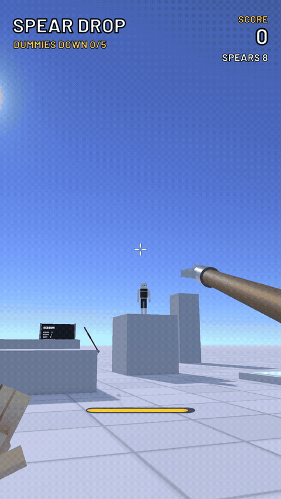
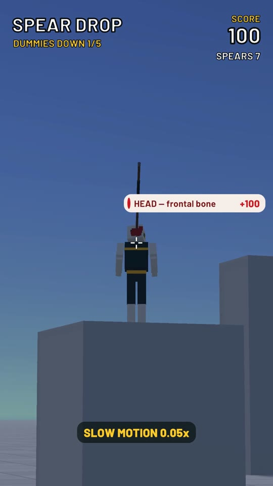
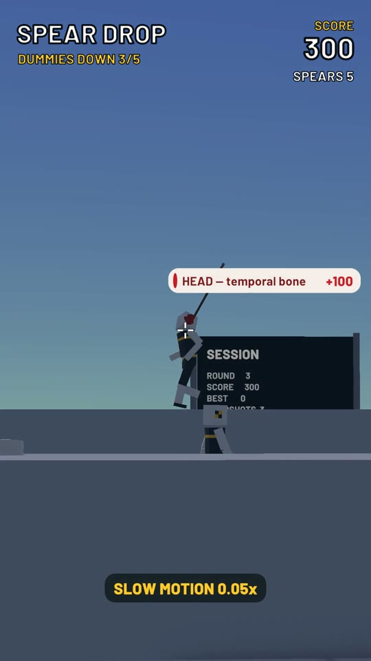

# Spear Drop

A first-person spear-throwing range: throw in slow motion, hit the test dummies, watch them go limp.

  
  

## How to play

- **Look** with the mouse (click the game view to lock the cursor, Esc to release) or the right stick. **Walk** with WASD or the left stick.
- **Hold** the left mouse button, Space or the right trigger to raise and pull back the spear; the power bar fills. **Release** to throw.
- The spear flies in slow motion and the camera follows it. Just before impact time drops to 0.05x. On a hit the screen darkens, a tag names the bone you hit and the dummy goes ragdoll with the spear stuck in it.
- Goal: drop all five dummies with eight spears. Head 100, chest 50, hip 40, limbs 25. The round restarts when every dummy is down or the spears run out. **R** restarts.

## How to open it

1. Open the folder in **Unity 6000.5.4f1** (URP, Input System). Unity restores the packages from `Packages/manifest.json`.
2. Open the scene `Assets/SpearDrop/SpearDrop.unity`.
3. Press **Play**.

The map, dummies, spear, hands and UI are all built at runtime from Unity primitives by `SpearDropGame`. The Satura Space editor hooks are inside `#if UNITY_EDITOR && SATURA_SPACE`, so the project opens and plays in plain Unity.

## Created by Satura Space

This game was made with [Satura Space](https://github.com/saturadev/satura-space) ([saturaspace.com](https://saturaspace.com)), a free, open source tool for building Unity games with AI agents. A TikTok link ([inspired by @headtop._demon1](https://www.tiktok.com/@headtop._demon1/video/7705594909620735246)) was pasted into Satura Space. A Claude agent watched the clip's frames, searched GitHub for how others solved the core mechanic (thrown projectiles that stick, ragdolls on impact, ballistic aim), built the game in Unity, playtested it with a bot and filmed it.

## Model and cost

Claude Opus 5.5 (low effort) in Claude Code. At Anthropic API list prices this run would have cost about **$6.19**. That is an estimate: 168 input tokens, 97,231 output tokens, 13,066,889 cache-read tokens and 204,262 cache-write tokens (1 hour), summed across every session for the game.

## Credits

- Idea: [@headtop._demon1](https://www.tiktok.com/@headtop._demon1/video/7705594909620735246) on TikTok.
- Code, models and art are original, built from Unity primitives, and released under the MIT licence.
- Techniques adapted and rewritten (see `Assets/ThirdParty/CREDITS.md`):
  - [marcelisdead/WreckBow](https://github.com/marcelisdead/WreckBow) (CC0-1.0): an arrow that faces its velocity and sticks on impact.
  - [mixandjam/Superhot-BulletTime](https://github.com/mixandjam/Superhot-BulletTime) (MIT): kinematic body parts switched to dynamic on a hit.
  - [mnijaki/AutoAimBowAndArrow](https://github.com/mnijaki/AutoAimBowAndArrow) (MIT): the launch-angle equation used by the demo bot.
- Font: [Barlow](https://github.com/google/fonts/tree/main/ofl/barlow) by The Barlow Project Authors, SIL Open Font License 1.1.
- TextMesh Pro Essential Resources (Unity package content) include Liberation Sans, SIL Open Font License 1.1 (`Assets/TextMesh Pro/Fonts`).
